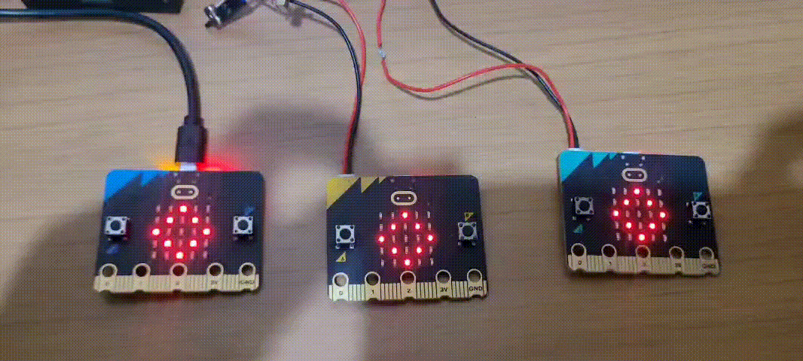

# EmergingConstellation

A small swarm of BBC micro:bit v2 boards that synchronize their blinking through radio pulses, without any central coordinator. Each board follows a simple local rule, and the group-level behavior emerges from their interactions.

> **Status:** three boards synchronize and pass a wave around the ring. Measurement of synchronization time versus number of nodes is in progress.

## Concept


Each board is a pulse-coupled oscillator:

1. We begin with a simple radio transmission; to make it easier to visualise, every time one board communicates with another, a pulse animation begins.
2. Transmission (TX) is detected when an animation starts from the centre and expands outwards towards the edges; when a frame is received (RX), another animation begins at the edges and moves inwards towards the centre of the array.
3. Its phase advances over time. When it reaches 1, the board fires: it flashes and broadcasts a pulse over the 2.4 GHz radio.
4. When a board receives a pulse, it advances its phase along a concave response curve (Mirollo–Strogatz). If the advance reaches the threshold, the board fires right away (absorption).
5. A board is *synchronized* when every neighbor has been within 0.05 periods of its own firing for several consecutive pulses.

No board knows the global state, yet the group converges to a shared rhythm. The model follows Mirollo and Strogatz (1990), inspired by the synchronization of fireflies.

## Demonstration: the wave

When a board detects synchronization, it schedules a wave after a short random delay. The wave is a column sweep across the 5×5 LED matrix, passed from board to board in ID order. Each board plays the sweep once and forwards the wave to its next neighbor, so one lap around the ring is one complete wave.



## Roadmap

- [x] **Phase 0:** Hello world on a single board
- [x] **Phase 1:** Two boards exchanging pulses over radio
- [x] **Phase 2:** Neighbor table with timestamps and RSSI
- [x] **Phase 3:** Pulse-coupled oscillator and first synchronization
- [ ] **Phase 4:** Measurement of synchronization time versus number of nodes, distance, and radio power
- [ ] **Phase 5:** Other behaviors: clusters, repulsive coupling, Kuramoto model (a traveling wave on synchronization is already implemented as a demo)

## Hardware

- BBC micro:bit v2 (three boards tested; five or six planned)
- USB cable for flashing and serial monitoring
- USB power bank or battery pack for untethered operation (later phases)

## Software

- [PlatformIO](https://platformio.org/) with VS Code
- Platform: `nordicnrf52`
- Board: `bbcmicrobit_v2`
- Framework: `arduino`
- Libraries:
  - [MicrobitV2-HHS](https://github.com/Grrtzm/MicrobitV2-HHS) for the nRF52 radio driver
  - Adafruit Microbit library for the LED matrix

## Getting Started

Clone the repository and build the firmware:

```bash
git clone https://github.com/vinyIsCollapsing/EmergingConstellation
cd EmergingConstellation
pio run
```

Flash the board and open the serial monitor:

```bash
pio run -t upload
pio device monitor
```

Expected output on boot and during synchronization (values vary per board):

```
Device ID (32-bit): 0xB3702CCF
MY_ID (8-bit): 207
Initial phase: 0.948
FIRE | t=1119 phase_after=0.000
KICK | id=84 before=0.186 after=0.200
PHASE | id=84 diff=0.185 phase=0.200
SYNC | synchronized, arming wave
WAVE | start local, id=1
```

## Project Structure

```
EmergingConstellation/
├── platformio.ini    # Build configuration (board, platform, framework, libraries)
├── src/
│   └── main.cpp      # Firmware entry point
├── include/          # Project header files
├── lib/              # Project-specific libraries
└── test/             # Test code
```

## Design Notes

- **Timing:** the main loop never blocks. The oscillator uses `millis()`, not `delay()`.
- **Radio:** the Arduino core does not expose the micro:bit radio. The project uses MicrobitV2-HHS, a port of the Lancaster University radio driver. Packets have a fixed length, and the library's length field includes a 3-byte header, so the payload length is derived from `MICROBIT_RADIO_HEADER_SIZE`.
- **Node IDs:** the low byte of the chip's factory ID. With 256 possible values, two boards can collide in a larger swarm. Each board checks the IDs it receives, and three boards with distinct IDs were tested.
- **Coupling:** a linear phase increment did not converge. The periods locked at a fixed offset of about 0.26 periods. The concave response with absorption (`RESP_B = 3`, `EPSILON = 0.02` in state units) brought the boards to within 0.004 periods (about 8 ms).
- **Clock drift:** the boards' clocks differ by about 6 to 7 ppm, measured before coupling was enabled. Once the oscillators are coupled, their periods match, and the drift estimate no longer reflects the crystals.
- **Synchronization criterion:** every neighbor must stay within `|diff| < 0.05` for `SYNC_PULSES` consecutive pulses. The residual offset of about 0.004 is the radio and processing latency.

## References

- R. E. Mirollo and S. H. Strogatz, "Synchronization of Pulse-Coupled Biological Oscillators", *SIAM Journal on Applied Mathematics*, 1990.
- P. W. Anderson, "More Is Different", *Science*, 1972.
- MicrobitV2-HHS library: https://github.com/Grrtzm/MicrobitV2-HHS

## License

To be defined.